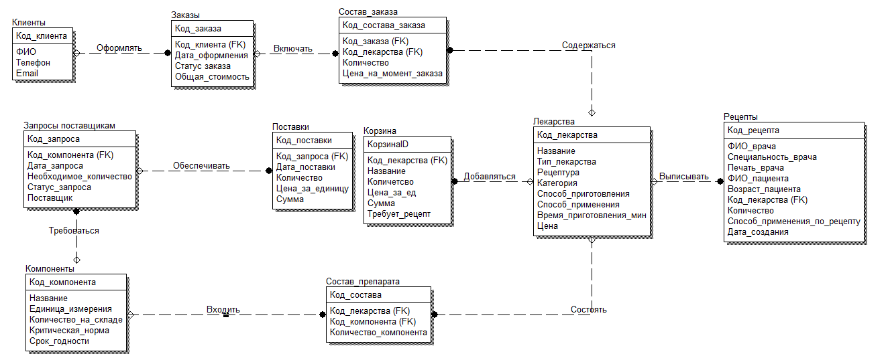
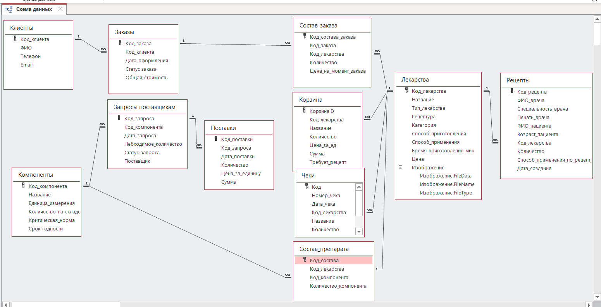
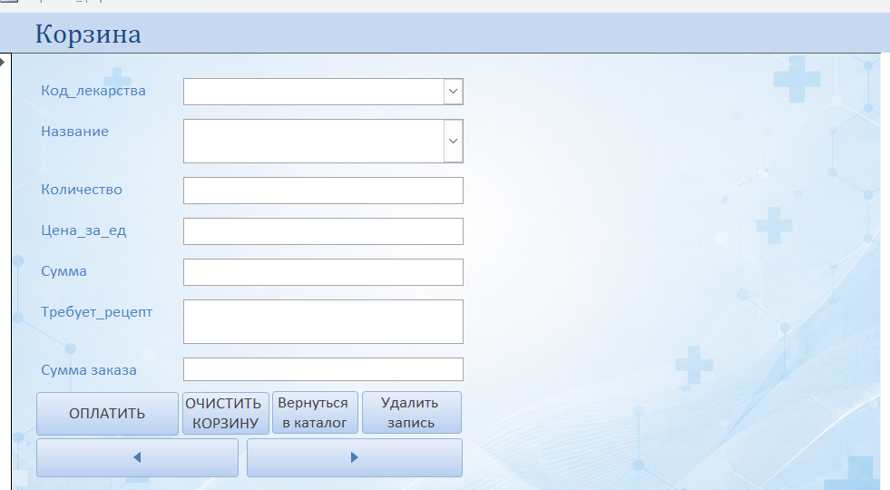

# МедЭксперт — база данных и приложение для аптеки

**Тип проекта:** учебное настольное приложение (учебная практика)
**Платформа:** Microsoft Access
**Технологии:** Microsoft Access, SQL, QBE, VBA (разработка с помощью ИИ)

**English version:** [README in English](README.md)

## О проекте

«МедЭксперт» — учебное приложение на Microsoft Access, моделирующее работу аптеки: каталог лекарств, корзина, ввод рецептов, учёт заказов, контроль остатков компонентов, запросы поставщикам и печатный чек. Проект объединяет реляционную базу данных (11 таблиц) с интерфейсом на формах, SQL- и QBE-запросами и отчётами.

Аптека продаёт готовые лекарства и изготавливает препараты по рецепту из компонентов, поэтому в базе учитываются и готовые товары, и компоненты, из которых делаются лекарства.

Это учебный прототип, а не промышленная система. Все тестовые данные клиентов и рецептов в проекте вымышленные.

## Проект базы данных

**ER-диаграмма**

**Схема данных в Access**

**Таблицы**

| Раздел | Таблицы |
|---|---|
| Товары | `Лекарства`, `Компоненты`, `Состав_препарата` |
| Продажи | `Клиенты`, `Заказы`, `Состав_заказа`, `Чеки`, `Корзина` (временная) |
| Рецепты | `Рецепты` |
| Снабжение | `Запросы поставщикам`, `Поставки` |

## Примеры запросов

В отчёте описано 7 SQL-запросов и 6 QBE-запросов. SQL-версии собраны с комментариями на английском в файле [`queries.sql`](queries.sql). Примеры:

- **Компоненты препарата** (запрос с параметром, соединение трёх таблиц) — [результат](docs/query-results/drug-info.png)
- **Лекарства для заказов в производстве** (подзапрос) — [результат](docs/query-results/drugs-in-production.png)
- **Цены компонентов по препаратам** — [результат](docs/query-results/component-prices.png)
- **Топ-10 самых используемых лекарств** (QBE) — [результат](docs/query-results/top-10-medicines.png)
- **Компоненты на уровне критической нормы или ниже** (QBE) — [результат](docs/query-results/critical-stock.png)

## Интерфейс

| | |
|---|---|
|  **Главное меню** — раздел клиента или персонала |  **Меню персонала** — фармацевт-технолог, кладовщик, администратор |
|  **Каталог лекарств** — сведения, рецептурность, цена, изображение |  **Корзина** — позиции, количество, суммы |

Алгоритм работы приложения: [docs/03-app-flow.png](docs/03-app-flow.png)

## Основной сценарий работы

1. Пользователь выбирает **«Для клиента»** в главном меню.
2. Открывает каталог и добавляет товар в корзину.
3. Для рецептурного препарата сначала открывается форма ввода рецепта.
4. Проверяет позиции и общую сумму в корзине.
5. Кнопка оформления запускает сценарий, описанный в отчёте по практике (чек, запись заказа, история продаж, проверка остатков), и открывает отчёт-чек.

Кнопка называется «Оплатить», но платёжная система не подключена и реальные платежи не обрабатываются.

## Другие возможности (по отчёту о практике)

- Формы-справочники: лекарства, компоненты, заказы, поставки, рецепты.
- Контроль остатков: компоненты на уровне критической нормы или ниже попадают в отчёт и в запросы поставщикам.
- Отчёты: история продаж за период, компоненты, заканчивающиеся препараты, рецепты, чек покупателя.
- Статусы заказов («в производстве», «ожидает поставки», «не забран») используются в запросах.

## Мой вклад

- Создавал и настраивал формы Access и интерфейс; меню сделаны встроенным инструментом Access «кнопочная форма».
- Проектировал структуру базы данных и связи с помощью ИИ, оформил диаграммы IDEF0 и ERD.
- Работал с SQL- и QBE-запросами при помощи ИИ, затем разбирался в результатах и проверял их.
- Использовал VBA-код, сгенерированный ИИ, для автоматизации.
- Проверял основные сценарии и исправлял найденные ошибки.

## Ограничения и возможные улучшения

- **Нет реального разграничения доступа.** Меню персонала даёт только навигацию по ролям, без авторизации и прав.
- **Таблица «Чеки» не нормализована:** по строке на позицию, название и цена повторяются; лучше разделить заголовок чека и строки чека.
- **Рецепты связаны только с лекарствами**, но не с заказами и клиентами.
- **Часть полей имеет текстовый тип**, хотя подошли бы числа (например, возраст пациента и количество в «Рецептах»).
- **Одна общая корзина.** «Корзина» — одна временная таблица, приложение рассчитано на одного пользователя.
- **Только Windows и Microsoft Access.**
- Использовать только вымышленные данные. Не хранить в прототипе реальные сведения о пациентах, рецептах или клиентах.

## Статус

Учебный прототип. Исходный файл `.accdb` в репозиторий не включён. В планах: скриншоты заполненной корзины и сформированного чека, демонстрационная копия базы с вымышленными данными.
