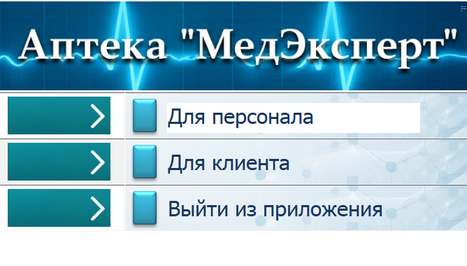
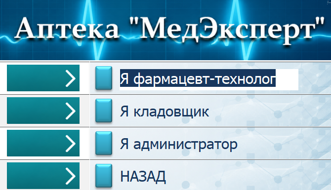
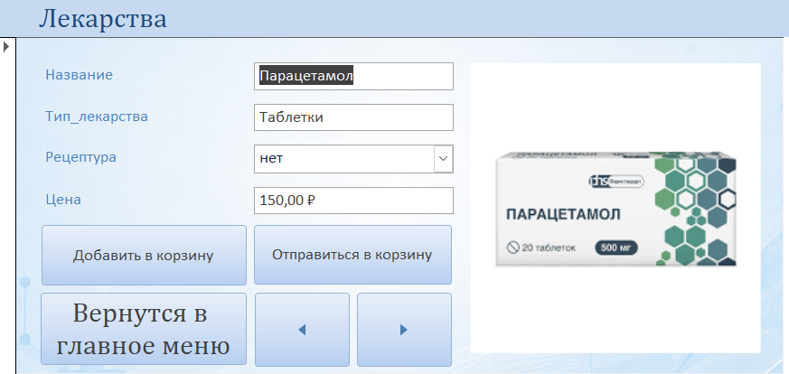

# МедЭксперт — база данных и приложение для аптеки

**Тип проекта:** учебное настольное приложение  
**Платформа:** Microsoft Access  
**Технологии:** Microsoft Access, SQL, QBE, VBA (разработка с помощью ИИ)

**English version:** [README in English](README.md)

## О проекте

«МедЭксперт» — учебное приложение на Microsoft Access, моделирующее отдельные процессы работы аптеки. Оно объединяет пользовательский интерфейс на формах, реляционную базу данных, каталог лекарств, корзину, ввод данных рецепта и формирование отчёта-чека.

Проект создан в учебных целях. Это прототип, а не готовая промышленная система для действующей аптеки.

## Скриншоты интерфейса

### Главное меню

Стартовая форма позволяет перейти в раздел клиента или персонала.

### Меню персонала

Меню содержит переходы к разделам фармацевта-технолога, кладовщика и администратора.

### Каталог лекарств

Форма каталога показывает сведения о лекарстве: название, тип, необходимость рецепта, цену и изображение. Также доступны элементы управления для добавления товара в корзину и перехода к ней.

### Корзина

В форме корзины предусмотрены поля для выбранного лекарства, количества, цены за единицу, суммы позиции, признака рецептурности и общей суммы заказа. На текущем скриншоте показана структура формы; следующим улучшением будет снимок заполненной корзины.

## Основной сценарий работы

1. Пользователь выбирает пункт **«Для клиента»** в главном меню.
2. Открывает каталог лекарств и выбирает товар.
3. Если товар рецептурный, приложение открывает форму ввода рецепта. После ввода данных рецепта товар можно добавить в корзину.
4. Пользователь проверяет позиции и общую сумму в корзине.
5. Пользователь нажимает кнопку оформления заказа. Приложение открывает отчёт-чек с позициями заказа, общей суммой, датой и информацией о продавце.

**Важно об оплате:** кнопка «Оплатить» запускает сценарий оформления заказа и открытия чека. Внешняя платёжная система не подключена, реальные платежи приложение не обрабатывает.

## База данных и запросы

В сопроводительном отчёте описана реляционная база данных с таблицами для:

- клиентов и лекарств;
- компонентов и состава препарата;
- заказов и состава заказа;
- рецептов;
- запросов поставщикам и поставок;
- чеков и истории продаж;
- временного хранения товаров в корзине.

В отчёте также описаны SQL-запросы на выборку и QBE-запросы для поиска заказов в производстве, просмотра сведений о препаратах и компонентах, анализа складских остатков и формирования выборок за определённые периоды.

Это учебные примеры, а не подтверждение готовности системы к промышленной эксплуатации или работе с реальными медицинскими данными.

## Мой вклад

- Самостоятельно создавал и настраивал формы Access и пользовательский интерфейс.
- Проектировал структуру базы данных и связи с помощью подсказок и ИИ.
- Работал с SQL- и QBE-запросами при помощи ИИ, затем разбирался в результатах и проверял их.
- Использовал VBA-код, сгенерированный ИИ, для автоматизации действий приложения.
- Самостоятельно проверял основные сценарии работы и исправлял обнаруженные ошибки.

## Область применения и ограничения

- Учебный прототип на Microsoft Access.
- Нет интеграции с реальной платёжной системой.
- Меню персонала демонстрирует навигацию по ролям; проект не позиционируется как промышленная система аутентификации и разграничения прав доступа.
- Использовать только вымышленные тестовые данные. Не хранить в прототипе реальные сведения о пациентах, рецептах или клиентах.

## Технологии

- Microsoft Access — таблицы, связи, формы и отчёты.
- SQL — запросы на выборку данных.
- QBE — конструктор запросов Access.
- VBA — автоматизация сценариев с использованием кода, сгенерированного ИИ и последующим ручным тестированием.

## Статус проекта

Учебный прототип. Репозиторий содержит описание проекта и выбранные скриншоты интерфейса. Дальнейшие улучшения: добавить диаграмму связей базы данных, примеры SQL/QBE-запросов, скриншот заполненной корзины и сформированного чека.
